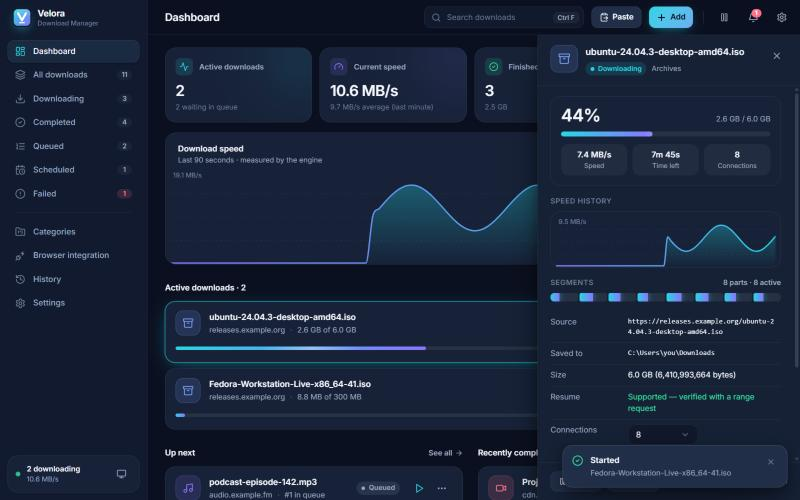

<p align="center">
  
</p>

<h1 align="center">Velora Download Manager</h1>
<p align="center"><strong>Download beautifully. Accelerate everything.</strong></p>
<p align="center">
  A fast, reliable, open-source download manager for Windows 10 and 11, with a Rust engine and a modern, animated interface.
</p>
<p align="center">
  <a href="https://github.com/ShahzaibAnwar/velora/actions/workflows/ci.yml"></a>
  
  
  
</p>

> **Alpha software.** The download engine is covered by automated tests, but Velora has not yet had broad
> real-world testing. Keep important downloads backed up and please report problems.


<sub>UI preview with sample data.</sub>

## Features

**Engine** (Rust, `crates/velora-engine`)
- HTTP and HTTPS with redirects, streamed straight to disk (never held in memory).
- **Multi-connection downloads** using byte ranges when the server proves it supports them, with
  **dynamic splitting**: a connection that finishes early takes over half of the largest remaining part.
- **Safe resume**, including after a crash or restart. Every ranged request carries `If-Range`, every
  `Content-Range` is checked, and a changed file on the server is detected instead of being stitched
  into corrupted output.
- Crash-safe checkpoints (written only after data is flushed) and atomic finalisation: a download is
  marked complete only after every byte is on disk and the file has been renamed into place.
- Retries with exponential backoff, jitter and `Retry-After`; permanent errors (404, 403, certificate
  problems, full disk) fail fast with a readable message.
- Real bandwidth limiting (global, per download, and a scheduled limit for set hours).
- Optional SHA-256 verification.
- **Video sites and streams** through [yt-dlp](https://github.com/yt-dlp/yt-dlp): YouTube, Vimeo,
  Instagram, TikTok, SoundCloud and more, plus HLS (`.m3u8`) and DASH (`.mpd`) links, with a choice of
  resolution or audio only. ffmpeg merges separate video and audio. Both are fetched from their
  official releases on first use and verified against the published SHA-256 lists.
- **BitTorrent** magnet links and `.torrent` files (librqbit), with metadata caching and resume.
- Keeps the PC awake while downloads run.

**Management**
- Persistent queue with priorities, drag-to-reorder and a maximum number of simultaneous downloads.
- Scheduling: start at a set time, or only run the queue inside a daily time window.
- Categories with optional per-category folders, duplicate-link and file-name conflict handling.
- History grouped by day, search, import and export.

**Windows integration**
- Tray icon, minimise or close to tray, native notifications, taskbar progress.
- Launch on startup, single instance, native folder pickers, open file / show in Explorer.
- Per-user NSIS installer — no administrator rights needed.

**Browser integration** (`extensions/`)
- Chrome, Edge and Firefox extensions: context menu, “send this page”, and a scan for direct media
  and file links on the current page.
- **X (Twitter) videos:** send a public post (or paste its link) and Velora downloads the post's own
  MP4 file, with a choice of quality. Public posts only; no sign-in or cookies are used.
- Native messaging plus a local named pipe with a per-user token and one-time approval of each
  extension. No network port is ever opened.
- Optional download handoff (off by default, filtered by type and size).

**Design**
- Dark and light themes designed separately, accent colours, compact density.
- Purposeful motion (150–300 ms springs) with full reduced-motion support; decorative animation
  pauses when the window is hidden.

## What Velora does not do

- It does not bypass DRM, paywalls, logins or any access control, and it never reads browser cookies.
- It does not download from DRM-protected subscription streaming services (Netflix, Prime Video,
  Disney+…). Videos that need you to be signed in are not downloaded either.
- It does not seed torrents or open a listening port; it downloads and stops.
- It never disables TLS certificate checks.
- It has no accounts, telemetry, ads or cloud services.
- Schedules run only while Velora is running (it can sit in the tray); there is no background service.

## Install

Pre-release installers are published on the [Releases page](https://github.com/ShahzaibAnwar/velora/releases)
as `Velora Download Manager_<version>_x64-setup.exe`. The installer is per-user and needs no
administrator rights. Until the first release is published, build from source.

Velora's alpha builds are **not code-signed**, so Windows SmartScreen (and Smart App Control, if
enabled) may warn about or block them.

## Build from source

Requirements: Windows 10/11 x64, [Rust](https://rustup.rs) (stable, MSVC), Node.js 20+,
Visual Studio 2022 Build Tools with “Desktop development with C++”, and the WebView2 runtime
(preinstalled on Windows 11).

```bash
git clone https://github.com/ShahzaibAnwar/velora.git
```

```bash
cd velora
```

```bash
npm install
```

```bash
npm run app:dev
```

```bash
npm run app:build
```

The installer is written to `target/release/bundle/nsis/`.

Other useful commands:

| Command | What it does |
| --- | --- |
| `npm run dev` | UI only, in a browser, with clearly labelled sample data |
| `npm run check` | TypeScript, ESLint and frontend unit tests |
| `cargo test --workspace` | Engine unit and integration tests (local test server) |
| `node scripts/sync-extensions.mjs` | Copy shared extension code to the Firefox build |

### Browser extension (development)

1. In Velora, open **Browser integration** → **Connect browsers**.
2. Chrome/Edge: `chrome://extensions` → Developer mode → **Load unpacked** → `extensions/chromium`.
   Firefox: `about:debugging` → This Firefox → **Load Temporary Add-on** → `extensions/firefox/manifest.json`.
3. Right-click a link → **Download link with Velora**, then approve the extension in Velora.

## Project layout

```
crates/velora-engine   Download engine (no UI dependency) + integration tests
src-tauri              Desktop app: commands, tray, notifications, browser bridge
src                    React + TypeScript UI (features/, components/, lib/)
extensions             Chromium and Firefox extensions
docs                   Vision, architecture, security, plans
```

See [docs/ARCHITECTURE.md](docs/ARCHITECTURE.md) for how it fits together and
[docs/IMPLEMENTATION_PLAN.md](docs/IMPLEMENTATION_PLAN.md) for status.

## Contributing

Contributions are welcome — see [CONTRIBUTING.md](CONTRIBUTING.md). Please report security issues
privately as described in [SECURITY.md](SECURITY.md).

## License

[MIT](LICENSE). Velora is an independent project and is not affiliated with Internet Download
Manager, Free Download Manager, JDownloader, aria2 or Motrix. Those names are mentioned only to
describe comparable software.
